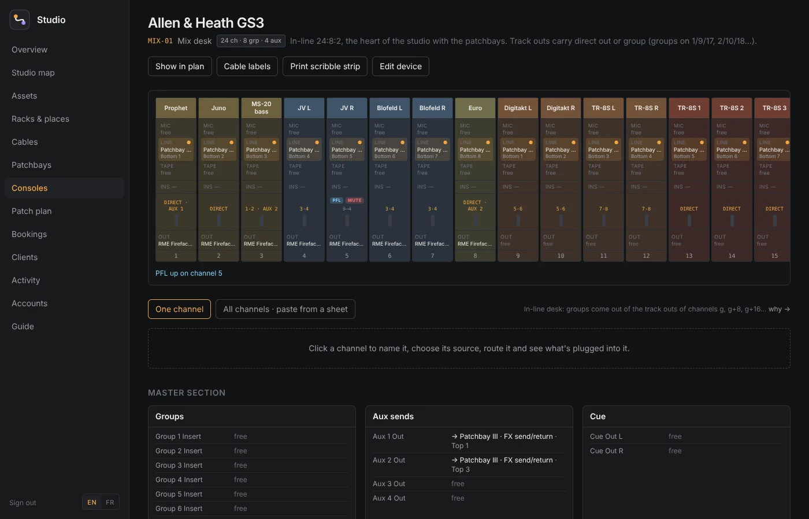

# Studio manager

A private back-office for an electronic music studio, built on [GoHead](https://github.com/gohead-cms/gohead).
Every machine, every cable and every session in one place — with the patchbays and the desk modelled properly,
so the app can tell you where a signal actually goes.

**📖 [Documentation](https://sudo-bngz.github.io/momo-studio/)** · [Guide](https://sudo-bngz.github.io/momo-studio/guide.html) · [Setup & deploy](https://sudo-bngz.github.io/momo-studio/setup.html)



What's in it:

- **Assets**: every synth, expander, drum machine, interface, patchbay and monitor, with its code, location, rack position, serial, purchase price, value, warranty and maintenance log. A gallery of **photographs** (front, rear panel, serial plate — scaled down in the browser so the server keeps small files), and for anything not photographed yet the app **draws the machine** from its category: keys for a synth, pads for a drum machine, two rows of jacks for a patchbay, faders for a console.
- **Ports**: each device lists its sockets (name, in/out, signal, connector). Cables plug into ports by name.
- **Cables**: every cable has a label code (`C-001`) and joins two ports. The app refuses a cable into a port that is already taken, refuses renaming a port that still has a cable, and flags anything odd: wrong signal, two outputs joined, unknown ports.
- **Studio map**: a floor plan of the rooms, with every rack, desk, stand and pedalboard where it really is, and the cable runs between them bundled by signal (hover a bundle for its cables). Click a place to zoom in: a rack opens as a front view, unit by unit; a desk or stand shows its machines, the cables between them, and where the others go. Edit the layout by dragging, resizing and turning places, moving them between rooms, and placing machines on a desk.
- **Consoles**: a mixing desk drawn as its channel strips. Each strip shows what's plugged into its mic, line, tape and insert sockets, its name, its routing (direct out, group pair, mix, aux sends up) and which socket its signal leaves by; the master section lists groups, auxes, mix, FX returns, 2-track, monitors with what each is wired to. Edit one channel or paste a row from a sheet, and print a scribble strip for the faders. An aux send that comes back into a channel sending to that aux (through pedals and patchbays) is flagged.
- **Templates**: a device's sockets in one click: Allen & Heath GS3 24/8/2 and 16/8/2, a generic console, interface or patchbay sized by a few numbers, a synth, a pedal. In *Add gear → Ports → Start from a template*; templates live in `src/lib/templates/devices.json`, add your own gear there.
- **Patchbays**: each patchbay drawn like the hardware, two rows of jacks numbered like the front panel (1–24 on top, 25–48 below), the label of every point, its mode (Normal, Half-normal, Thru), its DAW track and a group color. A point is named by the cable plugged in its rear (“Big Muff · Out”), or by a typed label for gear you haven't added. Edit one column, or every column as a table, and paste rows straight from Google Sheets or Excel. Print the designation strips at your jacks' real spacing.
- **Loop guard**: a pedal whose output comes back to its input, through a normalled column or a chain of effects, is flagged in red with the column to switch to Thru.
- **Patch plan**: the whole studio as a signal-flow diagram (sources on the left, what they feed on the right), filterable by signal, focusable on one device, downloadable as SVG.
- **Cable labels**: two printable wrap-around labels per cable, one per end, each saying where both ends go.
- **Racks & places**: rack elevations (U by U) and what sits on each desk, shelf or case.
- **Activity**: every change to the studio's content — who, what, when — with a filter by person, type and kind of change. Each entry has its own history: compare a version against the previous one or against the content as it stands, and put it back. Deleted entries are listed under *Recently deleted* and come back under the same id. GoHead records all of this as each change happens, in the same transaction, so the trail can't drift from the data.
- **Accounts**: add the people who help in the studio, give them a role, change it or reset a password. Everyone signs in as themselves, which is what makes the trail worth reading.
- **Calendar feed**: `/bookings.ics`, to subscribe to from Google Calendar, Apple Calendar or a phone.
- **Bookings**: a week calendar per room, with clients, price and paid status, and the gear a session needs. Overlapping sessions in the same room, or the same machine reserved twice, are refused unless you say otherwise.
- **English and French**: the whole interface, the help panels and the guide, switchable from EN | FR at the bottom of the sidebar. The language is remembered in a cookie and, on a first visit, taken from the browser — a French browser gets French without choosing. Dates, times and money follow it (`lun. 26 oct.`, `1 200 €`), and the words are studio French: a patchbay is a *baie de brassage*, a normalled column is *normalisée*, a tentative booking is an *option*. English stays the source: every French file is typed against its English counterpart, so a missing key is a compile error rather than a word that silently stays in English.
- **Help**: every page carries a panel whose first sentence is always on screen and whose detail is one click away — what each column, badge and field means, and the common task in order. `/guide` is the same text at length, with drawings: one channel of an in-line desk from socket to socket, how its group buses land on the channels' track outs, and what a patchbay column's three modes do. All of it lives in `src/lib/help/`, one file per language, so the page and the manual can't drift apart.

Stack: Next.js 16 (App Router, Server Actions), React 19, Tailwind CSS 4, `@gohead-cms/client`. No database of its own: everything lives in GoHead.

## Quick start

Node.js 20.9+ and Docker. Five minutes, from nothing to a studio you can click around.

```bash
git clone https://github.com/sudo-bngz/momo-studio.git studio-manager
cd studio-manager
cp .env.example .env.local
npm install
docker compose pull      # once, and whenever you move GoHead forward
docker compose up -d     # GoHead (API + admin) on http://localhost:8080
npm run gohead:setup     # content model, TypeScript types, roles, calendar secrets
npm run gohead:seed      # optional: a sample studio to click around
npm run dev              # http://localhost:3000
```

Sign in with `admin` / `gohead-local-password` — the defaults in `docker-compose.yml`. Change
them before this is reachable from anywhere but your laptop.

Run the commands one at a time: if `npm install` fails, everything after it fails too
(`gohead-client: command not found`, `next: command not found`) because there is no
`node_modules/`. If it fails with `UNABLE_TO_GET_ISSUER_CERT_LOCALLY`, see the next section.

**What you get.** `gohead:seed` loads a sample studio — a GS3 24/8/2, three patchbays, a
Eurorack case, pedals, monitors and 80 cables — so every page has something in it from the
first click. Worth opening in this order: **Assets**, then **Studio map**, then **Consoles**.
Every page explains itself: the panel at the top is always there, and **Guide** in the sidebar
is the whole manual, [also on the web](https://sudo-bngz.github.io/momo-studio/guide.html).

**Your own studio instead.** Skip `gohead:seed` and fill it in this order, which saves the most
typing: rooms and locations first, then the machines (fill the ports from a template where
there is one — the GS3 24/8/2 fills 163 of them, correctly named), then the patchbays with each
column's mode set to match the hardware, then the cables. If the patch already lives in a
spreadsheet, paste it a column at a time into the patchbay and console boards rather than
typing it again.

After a `git pull` that changed the content model, run `npm run gohead:setup` again.

### GoHead restarts every minute: `unknown command "standalone"`

```
Error: unknown command "standalone" for "gohead"
2026/10/22 20:12:34 Error executing command: unknown command "standalone" for "gohead"
```

The image is older than GoHead v0.6.0, which is where `standalone` landed. `docker compose up -d`
reuses a tag it has already pulled without asking the registry, so a `ghcr.io/gohead-cms/gohead`
image fetched before then keeps starting the old binary; `restart: unless-stopped` is what turns
that into a loop, one restart a minute.

```bash
docker compose pull && docker compose up -d
docker compose logs -f gohead      # "listening on :8080" means it's up
```

`docker-compose.yml` pins the minor (`0.7`), so this can't happen again on a fresh clone; `docker
compose pull` is how you move it forward, and `GOHEAD_VERSION=0.8 docker compose up -d` picks
another line. If `gohead` is a binary on your PATH rather than the container, it's the same cause —
update it, `gohead version` tells you what you have.

### `npm install` fails with `UNABLE_TO_GET_ISSUER_CERT_LOCALLY`

Something between you and `registry.npmjs.org` is re-signing TLS (a company proxy such as
Zscaler or Netskope, a VPN, an antivirus). macOS trusts its root certificate, but Node ships
its own list and ignores the keychain, so `npm` refuses the connection while Docker and the
browser work.

Check who signed the connection:

```bash
openssl s_client -connect registry.npmjs.org:443 </dev/null 2>/dev/null \
  | openssl x509 -noout -issuer
```

A public CA (DigiCert, Let's Encrypt…) means something else is wrong; a company or product
name confirms it. Then let Node trust the same roots as the system:

```bash
# Node 22.15+ / 24+
export NODE_OPTIONS=--use-system-ca
npm install
```

On an older Node, export the roots once and point Node at them:

```bash
security find-certificate -a -p /System/Library/Keychains/SystemRootCertificates.keychain > ~/.node-ca.pem
security find-certificate -a -p /Library/Keychains/System.keychain >> ~/.node-ca.pem
export NODE_EXTRA_CA_CERTS=~/.node-ca.pem
npm install
```

Add the `export` line to `~/.zshrc` to keep it. `NODE_EXTRA_CA_CERTS` adds to Node's list;
`npm config set cafile` *replaces* it, so only use that with a file that also holds the public
roots. `npm config set strict-ssl false` turns the check off altogether: it gets you unblocked,
but you are then downloading code over a connection nobody is checking, so turn it back on
(`npm config delete strict-ssl`) once the certificate is in place.

The `npm warn ERESOLVE overriding peer dependency` lines are unrelated and expected: ESLint 10
is newer than what `eslint-plugin-import` declares. The install works.

Starting with your own studio rather than the sample: skip `gohead:seed`, then in this order

1. **Racks & places → Rooms & locations**: your rooms, then your racks (with their height in U), desks, shelves, cases. Then **Studio map → Edit layout**: set each room's size, and drag every place where it stands.
2. **Assets → Add an asset**: each machine with its ports. The port editor has presets (stereo out, MIDI in/out/thru…) and numbered batches (“Line In × 8”).
3. **Patchbays**: open each one, set its columns, paste your sheet's rows (labels, modes, Ableton tracks) under *All columns · paste from a sheet*, then **Add the rear ports**.
4. **Cables → Add cable**, *patch it* next to a free port on a device's page, or *Patch the rear* on a patchbay column. Write the code on both ends, or print the labels.

## Who can sign in

People sign in with their GoHead user; the app keeps GoHead's token in an httpOnly cookie and acts as that user for every read and write, so GoHead's roles apply — and every change is recorded against the person who made it.

- Admins can do everything, including the **Accounts** page.
- `npm run gohead:access` creates the `studio-staff` role: full access to the studio's content and media, nothing else. Add `-- --user alex` to create a user of that role (the password is printed once). After that, add people from **Accounts** in the app, or in GoHead's own admin.
- Never share one account: the activity trail is only useful if a change carries a name.

### Single sign-on

GoHead grew OpenID Connect sign-in on `master` (`feat(auth): sign in with Google`, 22 Oct):
authorization code flow with PKCE, `GET /auth/sso` to list the providers, `/auth/sso/:provider/start`
and `/auth/sso/:provider/callback`, with a migration linking a GoHead user to its provider subject.
It is **not in v0.7.0**, the version `docker-compose.yml` pins — it lands in the release after it.

This app doesn't use it yet: its login page still takes a username and a password. Wiring it up is
a *Sign in with Google* button that hands off to GoHead and a route that accepts the token it sends
back, and it changes nothing else, because the app only ever holds a GoHead token — roles,
permissions and the activity trail keep working untouched. That is why SSO belonged in GoHead
rather than here: doing it in this app would have meant storing a GoHead credential per person,
and one shared API token would have destroyed the trail, since every change would read as the
token rather than as a person.

## Calendar

`/bookings.ics` serves the bookings as a calendar. `npm run gohead:access` creates a read-only
`calendar-feed` role, its API token (`GOHEAD_FEED_TOKEN`) and a secret (`STUDIO_ICS_SECRET`),
both written to `.env.local`. Subscribe with:

```
https://<the app>/bookings.ics?key=<STUDIO_ICS_SECRET>
```

In Google Calendar that is *Other calendars → From URL*; on a Mac, *File → New Calendar
Subscription*. Without the secret the feed is only served to someone signed in, so it stays
private by default — treat that URL as a password, and rotate the secret to revoke it.

Calendar apps refresh an external calendar on their own schedule, and Google's can be several
hours. The feed is right for seeing the week ahead on a phone, not for a change you made a
minute ago; for that, open the app. A two-way Google Calendar sync would need the Calendar API,
a Google Cloud project and a stored refresh token — more machinery than a studio of this size
needs, until it does.

## Scripts

| Script | What it does |
|--------|--------------|
| `npm run dev` / `build` / `start` | Next.js |
| `npm run lint`, `npm run typecheck` | ESLint; route types and `tsc` |
| `npm run gohead:push` | Applies `gohead/model.json` (never deletes types; `-- --dry-run` to preview) |
| `npm run gohead:types` | Regenerates `src/gohead.d.ts` from the model |
| `npm run gohead:access` | The `studio-staff` role (and a user with `-- --user <name>`) |
| `npm run gohead:seed` | Sample studio from `gohead/seed.json`: 2 rooms, 8 places, 24 devices (a GS3 24/8/2, 3 patchbays, pedals), 80 cables, bookings |
| `npm run gohead:setup` | `push`, `types` and `access` |
| `npm run docs` | Rebuilds the documentation site in `docs/` from `src/lib/help.ts` |

The setup scripts sign in with `GOHEAD_USERNAME` / `GOHEAD_PASSWORD` from `.env.local`.

## Documentation

<https://sudo-bngz.github.io/momo-studio/> — the home page, the [guide](https://sudo-bngz.github.io/momo-studio/guide.html)
and [setup & deploy](https://sudo-bngz.github.io/momo-studio/setup.html).

It's served by GitHub Pages straight out of `docs/` on `main`. To turn it on once:
**Settings → Pages → Source: Deploy from a branch → `main` / `/docs`**.

`npm run docs` regenerates `docs/*.html` from `src/lib/help.ts` — the same text the app shows in
the panel on each page and in **Guide**, so the site, the panels and the in-app manual can't drift
apart. Write the words once, in `help.ts`, and run `npm run docs` before committing.

The rest of `docs/` is written by hand: `style.css`, and `img/` — screenshots taken from a running
app, converted to WebP (the drawings of the channel strip and the in-line groups are lifted out of
the app's own `/guide` as SVG, with the theme colours resolved).

## Content model

| GoHead collection | What it holds |
|-------------------|---------------|
| `rooms` | Bookable rooms, with rates, a calendar color, and their size and place on the studio map |
| `locations` | Racks (with their height in U), desks, shelves, cases, storage; each in a room, with its footprint, position and rotation on the map (cm) |
| `devices` | The gear. `ports` is a repeatable `port` component: name, direction, signal, connector, balanced, note. Patchbays also have `patch_columns` and `patch_points` (a repeatable `patch_point`: column, top and bottom labels, mode, DAW track, color, note). Consoles have `console_channels` and `channel_strips` (a repeatable `channel_strip`: number, label, source, route, direct, aux, color, note) |
| `cables` | Label code, signal, state (connected / spare / broken), `from_device` + `from_port`, `to_device` + `to_port`, plugs, length, color |
| `maintenance` | Repairs, services and calibrations of a device |
| `clients` | Artists and people who book |
| `bookings` | Title, client, room, start and end, state, type, engineer, reserved devices, price, paid |

A patchbay's rear points are its ports `Top 1`…`Top N` and `Bottom 1`…`Bottom N` (the patchbay page adds them for you). Through a Normal or Half-normal column, the signal goes from whichever rear cable comes from an output to the other one; that's what the plan, the arrows (N↓) and the loop guard follow. Cords patched in the front aren't recorded.

A console is any mixer whose ports are named `Ch N Mic`, `Ch N Line`, `Ch N Tape In`, `Ch N Insert`, `Ch N Track Out` (or `Direct Out`), plus `Group N Insert`/`Out`, `Aux N Out`, `Mix Insert L`/`Out L`, `FX Return N L`… The templates name them so. A strip's `route` is free text the app reads numbers from ("1-2 + mix"): the groups it feeds; `direct` sends it to its own track out; on in-line desks without group out jacks, a group comes out of the track outs of channels g, g+groups, g+2·groups. An insert is one TRS jack: model an insert cable as two cables into the same `Ch N Insert` port (tick *Allow a shared port*).

A cable points at a device by relation and at its port by name, because GoHead relations can't target a component. That's why renaming a port with a cable in it is refused: the cable would lose its end.

GoHead can't filter on relations, so pages read cables and maintenance whole and join them in the app (`src/lib/data.ts`). That's instant for a studio's few hundred entries.

To change the model: edit `gohead/model.json`, then `npm run gohead:push && npm run gohead:types && npm run typecheck`. Enum labels and colors are in `src/lib/vocab.ts`; the typecheck tells you which ones are missing.

## Environment

| Variable | |
|----------|--|
| `GOHEAD_URL` | GoHead as the app's server reaches it (default `http://localhost:8080`) |
| `STUDIO_TIMEZONE` | Bookings are typed and shown in this zone (default `Europe/Paris`) |
| `STUDIO_CURRENCY` | Currency of prices and values (default `EUR`) |
| `STUDIO_ICS_SECRET` | Unlocks `/bookings.ics` for calendar apps; unset, the feed needs a session |
| `GOHEAD_FEED_TOKEN` | The read-only token the feed reads bookings with (both are written by `npm run gohead:access`) |
| `GOHEAD_USERNAME`, `GOHEAD_PASSWORD` | Setup scripts only: don't set them where the app is deployed |

## Deploying

### Render, in a few minutes

[`render.yaml`](render.yaml) is a Blueprint that brings up both halves:

[](https://render.com/deploy?repo=https://github.com/sudo-bngz/momo-studio)

1. Click the button, sign in to Render, and give it the two values it asks for:
   `GOHEAD_ADMIN_EMAIL` and `GOHEAD_ADMIN_PASSWORD` (**12 characters or more** — GoHead
   refuses to start with a shorter one). The username is `admin`, and the JWT secret is
   generated for you.
2. **Deploy Blueprint**. The first build takes a few minutes and creates:
   - **studio-cms** — GoHead with a 1 GB disk at `/data` holding the SQLite database, the
     uploaded photos and the secrets;
   - **studio** — this app, which reaches the CMS over Render's private network, so only the
     app really needs to be open to the world.
3. Push the content model from your machine, once:

   ```bash
   export GOHEAD_URL=https://studio-cms-xxxx.onrender.com   # the CMS service's URL
   export GOHEAD_USERNAME=admin GOHEAD_PASSWORD='what you typed in step 1'
   npm run gohead:push     # the collections and components
   npm run gohead:access   # the studio-staff role
   npm run gohead:seed     # optional: the sample studio
   ```

4. Open the **studio** service's URL and sign in with `admin` and that password.

About **$14.25 a month**: two instances at $7 and $0.25 for the disk. Render's free instances
have no disk and can't be reached on the private network, so the CMS has to be a paid one; set
the app's `plan` to `free` to save $7 if you don't mind it sleeping after 15 minutes and taking
about a minute to wake. The Blueprint uses the `frankfurt` region — Render can't move a service
later, so change it in `render.yaml` before deploying if you want another one.

Pushing to `main` redeploys the app. The CMS has `autoDeployTrigger: "off"` so it isn't rebuilt
every time; to move it to a newer GoHead, use **Manual Deploy → Clear build cache & deploy**.

Render snapshots the disk every 24 hours and keeps it at least seven days; restore one from the
service's **Disk** page. That disk is your whole inventory, so check the snapshots exist before
you rely on them.

### Anywhere else

GoHead's `standalone` mode (one process, SQLite, about 45 MB of memory) and this app both fit
on a Raspberry Pi or a small VPS:

1. Run GoHead as in `docker-compose.yml`, with your own admin password, and back up its `/data`
   volume.
2. `npm ci && npm run build && npm start` with `GOHEAD_URL` pointing at it (or containerize the
   app). Photos are streamed through the app's `/media` route, so GoHead itself doesn't have to
   be public.
3. Put the app behind HTTPS: the session cookie is `secure` in production, so sign-in silently
   fails over plain HTTP.

## Project structure

```
gohead/model.json, seed.json   content model and sample studio
scripts/                       role and user setup
src/
  app/(studio)/                pages: overview, assets, racks, places, cables, patchbays, consoles, plan, map, bookings, clients
  app/actions.ts               every write (Server Actions)
  app/login/                   sign-in
  app/media/                   private proxy for uploaded photos
  components/                  forms, port editor, patch plan diagram
  lib/data.ts                  every read
  lib/patch.ts                 the cable graph: port usage, issues, signal through normals, loops, plan layout
  lib/patchbay.ts              a patchbay as columns, labels from rear cables, pasting from a sheet
  lib/console.ts               a console as strips, routing, following a signal through the desk, aux loops
  components/device-figure.tsx a drawing of a machine per category, when there is no photo
  lib/templates.ts, templates/ device templates (GS3, generic console / interface / patchbay)
  lib/studio-map.ts            the floor plan: default layout, cable bundles between places, zoom cards
  lib/audit.ts                 the change trail: the feed, an entry's history, restoring a version
  lib/people.ts                accounts and roles, through GoHead's admin API
  lib/i18n/                    the languages: the locale, the formatters, one message file per area
  lib/help/                    every word of help: a topic per page, plus the glossary, per language
  components/help.tsx          the panel on each page, and inline terms
  components/signal-flow.tsx   the guide's drawings: a channel strip, in-line groups, normalling
  lib/session.ts               sign-in and the per-user GoHead client
  lib/time.ts                  studio time zone
  proxy.ts                     redirects visitors without a session to /login
```
